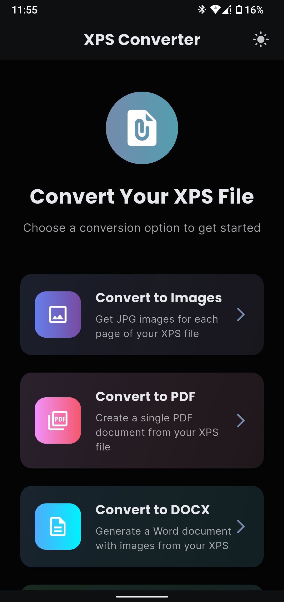
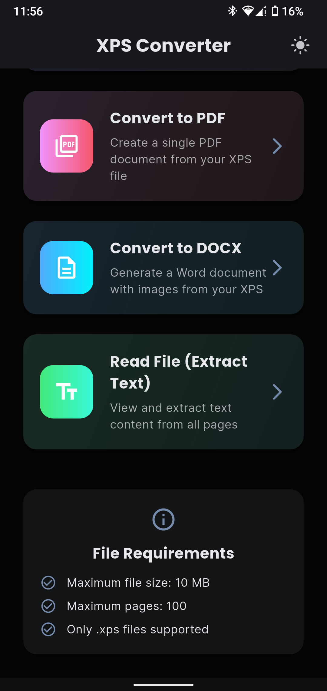
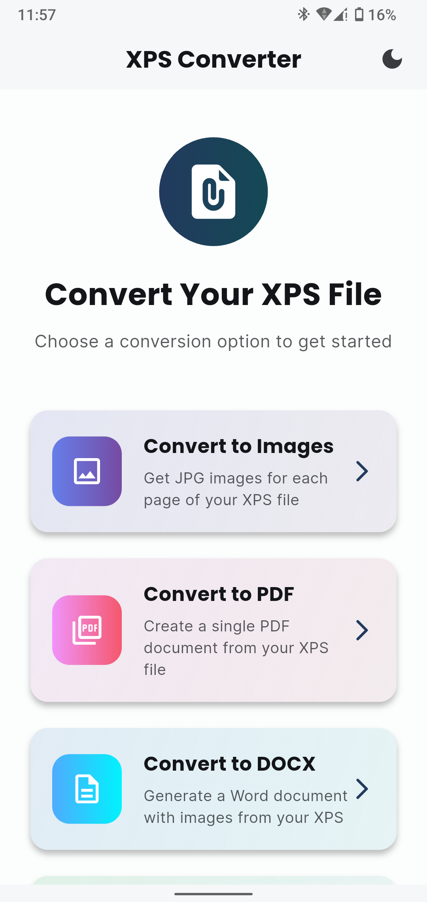

<p align="center">
  
  
  
</p>

# XPS Converter · Flutter client

A Flutter client for turning XPS documents into images, PDF, DOCX, or extracted text through the companion [conversion API](https://github.com/Imranxhah/xps_converter_backend).

**Flutter · Dart · Provider · Dio · File Picker**

## Capabilities

- Pick an `.xps` document and validate its size before upload.
- Request image, PDF, DOCX, or plain-text output from the REST API.
- Preview conversion results and download generated files.
- Download individual, selected, or all rendered page images.
- Remember the user's light or dark theme preference.

## Get started

```bash
git clone https://github.com/Imranxhah/xps_converter_flutter.git
cd xps_converter_flutter
flutter pub get
flutter run
```

The API origin is defined in [lib/config/api_constants.dart](lib/config/api_constants.dart). Point it at your own backend for local development.

## Architecture


| Location | Responsibility |
| --- | --- |
| [lib/providers/converter_provider.dart](lib/providers/converter_provider.dart) | Conversion workflow and result state |
| [lib/services/api_service.dart](lib/services/api_service.dart) | Multipart API requests and downloads |
| [lib/services/file_service.dart](lib/services/file_service.dart) | File selection, validation, saving, and opening |
| [lib/screens/type_selection_screen.dart](lib/screens/type_selection_screen.dart) | Conversion choice UI |
| [lib/widgets](lib/widgets) | Image, PDF, DOCX, and text result views |

## Repository status

The conversion services, providers, and result widgets are present, but the checked-in [lib/main.dart](lib/main.dart) currently instantiates placeholder classes instead of wiring those implementations into the app. Connect the real providers and screens before treating this branch as a release build. The screenshots document the supplied application UI.

## Development

```bash
flutter analyze
flutter test
```

No license file is included. Contact the owner to clarify reuse terms.

Built by [Imran Shah](https://github.com/Imranxhah).
